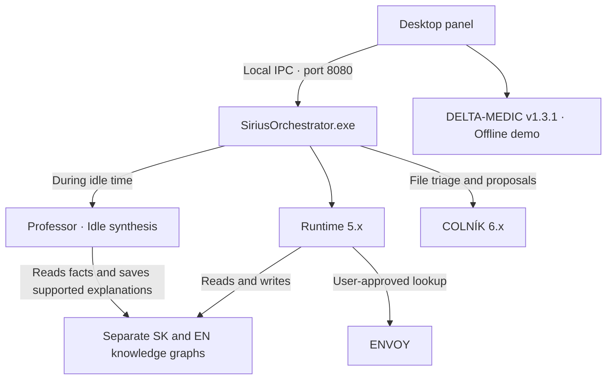

SIRIUS LOCAL AI BETA v6.1.0

Windows Preview · Offline-first symbolic AI · Slovak and English
SIRIUS LOCAL AI runs a symbolic reasoning engine and two separate knowledge graphs on your computer. Ask questions in Slovak or English from the desktop panel. When the local graph lacks an answer, you can approve an optional web lookup through ENVOY.
Download the Windows Preview
Quick start on Windows
Download `SIRIUS-LOCAL-AI-BETA-v6.1.0-Windows-Preview.zip` from the release page.
Extract the entire ZIP. Keep the `_internal` folder beside `SiriusOrchestrator.exe`.
Double-click `SiriusOrchestrator.exe`. Select SK or EN, or open DELTA-MEDIC (demo) from the menu.
The Windows build includes its Python runtime.
> **Windows startup notice.** This preview executable is unsigned. Windows may warn or block startup depending on your security settings. If it blocks SIRIUS, open a GitHub issue with your Windows version, the ZIP filename, and the exact error message.
>
> **Upozornenie pre Windows.** Pred spustením rozbaľte celý ZIP. Spustiteľný súbor je nepodpísaný a Windows môže podľa nastavení zabezpečenia zobraziť upozornenie alebo zablokovať štart. V prípade blokovania založte GitHub issue a uveďte verziu Windowsu, názov ZIP-u a presnú chybovú hlášku.
What’s new in v6.1.0
Professor
Professor scans the Slovak and English knowledge graphs in batches during idle time. It pauses when you use the panel and resumes after the next idle period. Its first rule builds an explanation about fish from explicit relationships covering classification, habitat, and examples of still waters. The saved explanation includes the supporting relationships and available source references.
Tests on copies of both graphs covered pause and resume, duplicate prevention, rejection when evidence was missing, and retry after a failed write.
DELTA-MEDIC v1.3.1
The DELTA-MEDIC (demo) panel runs offline and comes with five Slovak and four English sample records. You can search, edit, import, and export the records as JSON. English titles include a Slovak translation in parentheses.
The score display is an interface demonstration for sample data. The panel is for evaluation and does not provide clinical decisions or treatment recommendations.
Architecture
Windows Preview v6.1.0

Runtime uses `runtime5/runtime_core_5.py`. The orchestrator runs idle synthesis through `professor/idle_synthesis.py`. DELTA-MEDIC uses its own sample records.
<details>
<summary>Original architecture overview</summary>

</details>
Component	Role
`sirius_orchestrator.py`	Launches the desktop window and its loopback IPC bridge on port 8080.
`runtime5/`	Parses requests, queries the active knowledge graph, and handles optional ENVOY lookups.
`autosave_kg.json` and `autosave_kg_en.json`	Store the separate Slovak and English knowledge graphs. The Windows EXE uses writable copies in `SIRIUS_DATA`.
`professor/`	Handles fact extraction and idle-time synthesis from graph relationships.
`UI_PANEL/`	Contains the desktop panel, including the standalone DELTA-MEDIC demo.
`COLNIK-6.x/`	Provides guards and workflows for actions such as file triage and move proposals.
Windows Preview verification
Desktop launch and loading of both existing knowledge graphs were confirmed after deployment.
Slovak and English local responses were verified in the test build. The English test also verified that a user-approved ENVOY lookup saved a result that the next query could retrieve locally.
DELTA-MEDIC displayed all nine sample records in the installed desktop build.
A live Professor write still depends on the graph containing the required relationships. Automatic writes were verified on test copies.
Known issue. In the desktop test, IdentityEngine could not find `config/security_identity.json` and used its default settings.
Build from source on Windows
The preview build was produced with Python 3.10 and PyInstaller 6.20. With the project’s runtime and build dependencies installed, run these commands from the extracted build source root that contains `sirius_orchestrator.py` and `BUILD_EXE/SiriusOrchestrator.spec`.
```cmd
python -X utf8 -m unittest discover -s BUILD_EXE -v
python -X utf8 -m PyInstaller --noconfirm --workpath "BUILD_EXE\build_professor_delta" --distpath "BUILD_EXE\dist_professor_delta" "BUILD_EXE\SiriusOrchestrator.spec"
```
The output is in `BUILD_EXE\dist_professor_delta\SiriusOrchestrator`.
Development roadmap
BETA remains available at v6.1.0 while active development focuses on SIRIUS LOCAL AI GAMA. A future milestone is to connect BETA and GAMA through ENVOY.
License and author
MIT License
Richard Pizem · Lead architect and solo maintainer  
Banská Bystrica, Slovakia
